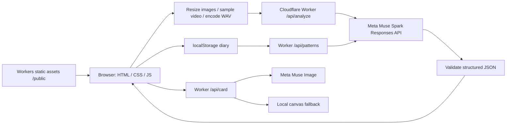
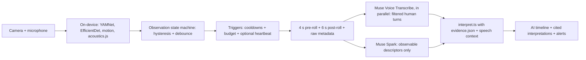

# PerritoTalk 🐾

Big feelings. Little clues. A mobile-first bilingual dog-behavior interpreter built for the **Meta Model API Hackathon**.

Live demo: **https://perritos.edevcore.com**.

Dogs communicate through a combination of sounds, posture and movement. PerritoTalk helps caregivers explore those signals with conservative interpretations and practical next steps. **Interpretation, not a diagnosis.** It cannot reliably infer a dog's internal state or replace a qualified veterinarian or behavior professional. Seek urgent veterinary care for emergencies.

## Features

- Upload a photo, video or audio; record camera/microphone clips with a 30-second automatic stop.
- Live Watcher: continuous on-device observations; triggered pre-roll clips, cooldowns and bounded AI sessions.
- Client-side acoustic hints for upload, camera and live recordings.
- Camera mode: batch 1–8 timestamped CCTV exports, timeline, evidence-based alerts and optional diary saving.
- English/Spanish interface, defaulting to browser language, with a persistent toggle.
- Warm, responsive design, dark-mode support, accessible controls and reduced-motion support.
- Three-layer readings: observed descriptors, cited possible interpretations with word certainty, and missing context; optional playful dog line and veterinary banner.
- Local dog diary (latest 100 readings), thumbnails, need frequency and time-of-day bars; ask Muse about patterns.
- Muse Image share cards with a browser canvas fallback, JPEG download (PNG for canvas fallback) and native Web Share where supported.
- Optional browser text-to-speech. A bundled original SVG dog powers the sample demo.

## How it uses Meta

The Worker calls `https://api.meta.ai/v1/responses` with **Muse Spark (`muse-spark-1.3`)**, multimodal image/video/audio content, conservative system instructions, low reasoning effort, and a strict JSON schema. MP4 includes embedded audio. Image inputs become JPEGs up to 1024 px. MP4 videos up to 12 MB pass through; other or larger video becomes four chronological JPEG frames up to 768 px plus mono 16 kHz WAV audio (first 30 seconds). Audio uploads and recordings become mono 16 kHz WAV, capped at 30 seconds. Maximum decoded media per request: 15 MB; maximum HTTP JSON body: 21 MB; maximum source file: 100 MB.

Muse Spark 1.3 has a documented audio-understanding caveat: our dog clips often return `NO_AUDIO`, including standalone WAV tests with 1.2 and 1.3. `public/acoustics.js` supplements the model with heuristic RMS, autocorrelation pitch and tonal-run hints from mono 16 kHz PCM (30 ms frames / 15 ms hop). Hints distinguish silence, music/noise, howl, whine/whimper, bark and unclear; they are not proof or a diagnosis. The UI displays a small `🔊 heard` chip. Confident dog-sound hints guide vocalization, evidence, labels and phrases; calm labels conflicting with howl/whine hints are flagged and capped at 0.39. Direct MP4 decoding failures omit hints while retaining embedded audio.

The strict `rms > max(0.02, p60)` activity gate can miss constant-level synthetic tones; tone tests include quiet context.

Browser codec support varies. If a video container's audio cannot be decoded, analysis stops rather than silently sending frames alone; export an MP4 with audio under 12 MB or upload WAV separately. Videos with unreadable duration/codecs require an MP4 export. Camera and microphone require HTTPS or localhost and browser permission.

Diary pattern analysis uses the same structured Responses API. Cards use **Muse Image (`muse-image-1.0`)** at `/v1/images/generations`, returning a 1024×1024 JPEG. Image generation failure falls back to local canvas. Analysis failures return a safe 502 instead of silently presenting mock content as live.

Without `MODEL_API_KEY`, or with `?mock=1`, the APIs return explicitly marked deterministic demos. Door/puerta context yields wants-out, limp/cojea/pain context yields a pain warning. Mock outputs never claim the uploaded content was inspected. Demo diary entries are marked as such and sent with their mode during pattern analysis. The live/mock health badge shows backend availability; each result has its own provenance badge.

## Meta stack

Standard-mode prices checked against [Meta pricing](https://dev.meta.ai/docs/pricing-rate-limits)
on 2026-11-03. Local watching never calls these services until a trigger. Enrichments
run for explicit upload/camera analyses, where SAM and ASR run in parallel before Spark.
**Live readings never call SAM**: ASR runs in parallel with Spark and only feeds
`interpret.ts`, so a live reading costs one Spark round trip.

| Model                          | ID                              | What it does in PerritoTalk                      | Why                                                           | Cost                                                              |
| ------------------------------ | ------------------------------- | ------------------------------------------------ | ------------------------------------------------------------- | ----------------------------------------------------------------- |
| Muse Spark 1.3                 | `muse-spark-1.3`                | Strict observable descriptors; default summaries | Interpretation stays in evidence-backed code                  | $1.25 input / $4.25 output per million tokens; cached input $0.15 |
| SAM 3.1                        | `sam-3.1`                       | Locates dogs in up to two middle keyframes       | Location hints (uploads only)                                 | $2.50 / 1,000 images; two frames cost $0.005                      |
| Muse Voice Transcribe          | `muse-voice-transcribe-1.0`     | Diarized human speech, filtered turns            | Context and human/dog whimper caveats                         | $0.18 / hour of processed audio                                   |
| Muse Image                     | `muse-image-1.0`                | Share card; canvas fallback retained             | Optional illustrated keepsake                                 | $0.01 / generated image                                           |
| Muse Wonder                    | `muse-wonder-1.0`               | Optional day/pattern summaries                   | Awaiting owner A/B decision; Spark remains default            | $4 input / $20 output per million tokens; cached input $0.20      |
| Realtime ASR websocket         | Muse Voice Transcribe streaming | Discarded for this workflow                      | Trigger-only clips; no measured gain from a persistent stream | Not used                                                          |
| Muse Glimmer / Muse Spark Open | 30B / 816B self-hosted weights  | On-prem NVR roadmap only                         | GPU infrastructure required                                   | Self-hosting not estimated                                        |
| Muse Code                      | Muse Code product               | Discarded for this repository                    | Owner uses Codex CLI                                          | Not used                                                          |

`USE_SAM` and `USE_ASR` default on; `false`, `0` or `off` disables them.
`SAM_MIN_CONFIDENCE` defaults to **0.5**. `ASR_MIN_TURN_MS=400` and
`ASR_MIN_WORDS=2` discard short/one-word hallucination candidates; both are
configurable engineering decisions, not accuracy claims. Only valid mono PCM16
WAV is sent as multipart `request` JSON + `audio`. Browser MP4 normalization and the
eval script provide two middle JPEGs and a separate 16 kHz WAV alongside the video.
If a valid auxiliary track/frame is unavailable, that enrichment is omitted.
Each enrichment has a ten-second deadline. Any SAM frame failure discards the
whole SAM result; either service failing continues to Spark without that hint.
`?mock=1` and `?watcher-dry=1` skip SAM/ASR entirely, even with a configured key.
Mocks include zero-checked SAM and empty speech shapes; they assert no detections.

SAM's `dogs` is the largest count above the configured gate in any checked frame,
not a sum of repeated dogs; `best_c`/normalized `box` retain the best raw detection.
`frames_checked` records coverage. The Observed layer displays the count; the live
canvas draws its box as **analyzed clip**, not a claim of current tracking. Masks
are ignored. SAM and speech text go to Spark as untrusted hints, never instructions.
Speech observations include qualifying turns, anonymous speakers and an excerpt
bounded at 160 characters. A heard voice satisfies the requested partner/interaction
context, but does not identify the owner or prove that the speaker is physically
beside the dog. With **I left** and qualifying speech, the separation pattern is
blocked and Still unknown asks who was with the dog. Whimper/human-voice ambiguity
is disclosed (AudioSet C42), with certainty capped at low.

There is no SAM gate on live readings any more: it added seconds of latency and could
skip readings of real dogs. Upload/camera readings always continue to Spark.
The server never logs transcripts, masks, request payloads or credentials.

`SUMMARY_MODEL` accepts `muse-spark-1.3` (default) or `muse-wonder-1.0`, for both
camera/day summaries and diary patterns. Descriptors always use Spark. To compare
exactly the same ten saved readings without changing the default:

```sh
# MODEL_API_KEY is already in the environment; never paste it into this command.
node scripts/ab-summary.mjs ../hack/clips/results_v4
# Or pass the new eval output directory / a JSON array of ten readings.
```

The A/B script makes **two paid Responses requests** with the same input/schema and
`reasoning.effort=low`. It reports latency, token usage including cached input,
Standard-price cost estimates, literal `forbidden_claims` phrase counts, suspected
assertions, uncalibrated percentages and “no audio” wording. The text checks are
lexical review flags, not semantic validation or accuracy. Media/base64 are omitted,
missing timestamps remain unknown, and neither key, payload nor full response is
printed. Rates are constants in the script with their source/date. This pass does
not run the paid A/B or ten-clip real evaluation; the owner chooses the default.

## Setup, run and test

Requires Node.js 22+ and npm. There is no frontend framework, bundler or build step.

```bash
npm install
cp .dev.vars.example .dev.vars
# Set MODEL_API_KEY in .dev.vars for live mode; leave empty for demo.
npm run dev -- --port 8787
```

Open `http://localhost:8787`. Try a sample always runs mock, even with a live key. Optional `.env.example` documents the key for other tooling; local Wrangler secrets belong in `.dev.vars`. Never put keys in `/public`.

```bash
npm run typecheck
npm test
npx wrangler deploy --dry-run
curl http://localhost:8787/api/health
curl 'http://localhost:8787/api/analyze?mock=1' \
  -H 'Content-Type: application/json' \
  --data '{"lang":"en","context":{"situation":"waiting by the door"},"media":[{"kind":"image","mime":"image/jpeg","data_b64":"/9j/2Q=="}]}'
```

The curl image is a minimal validation fixture, not a usable live photograph. Tests cover validation, deterministic mocks, structured response extraction and router behavior without network calls.

Evaluate a clip directory against a running endpoint (requires ffmpeg); writes `results/<name>.json`:

```bash
PERRITO_URL=http://localhost:8787 node scripts/eval-clips.mjs /path/to/clips
```

## Screenshots


## Architecture



## Project structure

```text
src/
  index.ts       Worker routing, request limits and endpoint orchestration
  schema.ts      Strict reading schema, input validation and confidence safeguards
  prompts.ts     Audio-first interpretation and diary instructions
  meta.ts        Meta Responses and image generation adapters
  mock.ts        Explicit deterministic demonstrations
  camera.ts      Camera summary validation and heuristics integration
  stream.ts      Planned streaming contract (501)
public/
  app.js         Bilingual UI, recordings, diary and camera workflow
  media.js       Image/video normalization, WAV encoding and acoustic hints
  acoustics.js   Pure PCM acoustic classifier, shared with clip evaluation
  live.js        Live camera/microphone sessions and overlay
  live-logic.js  Compatibility helpers and alert deduplication
  camera-heuristics.js  Shared browser/server camera alert rules
  index.html     Accessible app shell
  style.css      Responsive styles
  *.svg          Original sample illustration and favicon
tests/          Worker, schema, acoustics, calibration, camera and live tests
scripts/        eval-clips.mjs (ffmpeg evaluation), optional RTSP bridge
docs/           Camera bridge guide, screenshots and CI workflow template
wrangler.jsonc   Worker assets, domain and observability configuration
```

## Deploy

After reviewing the project, authenticate Wrangler to your Cloudflare account and configure the secret:

```bash
npx wrangler secret put MODEL_API_KEY
npm run deploy
```

`wrangler.jsonc` configures Workers static assets, `/api/*` Worker-first routing, observability and the `perritos.edevcore.com` custom domain. You must control the corresponding Cloudflare zone. No deployment is performed by project setup. See [Cloudflare asset configuration](https://developers.cloudflare.com/workers/static-assets/binding/).

## API reference

All POST endpoints accept JSON; responses use `Cache-Control: no-store`. Add `?mock=1` for deterministic demos. Missing server credentials also select mock mode. Errors: 400 invalid input, 405 unsupported method, 502 upstream/invalid model output; unknown routes return 404.

| Endpoint                   | Request                                                                                        | Response                                                                                                                                 |
| -------------------------- | ---------------------------------------------------------------------------------------------- | ---------------------------------------------------------------------------------------------------------------------------------------- |
| `GET /api/health`          | None                                                                                           | `ok`, `live`, `model`                                                                                                                    |
| `POST /api/analyze`        | `{lang, context?, context_mode?, baseline?, media, source?, acoustic_hints?, watcher?, deep?}` | `observations`, `interpretations` (states, word certainty, citations), `unknowns`, `dog_line`, `vet_alert`, compatibility fields, `mode` |
| `POST /api/patterns`       | `{lang, entries}` (1–100 compact diary entries)                                                | `summary`, `patterns`, `tips`, `vet_note`, `mode`                                                                                        |
| `POST /api/card`           | `{lang, dog_says, label, emoji, dog_name?}`                                                    | JPEG `b64_json`, `mime`, `mode`; or `{mode:"mock", fallback:true}`                                                                       |
| `POST /api/camera/summary` | `{lang, clips}` (1–8 timestamped readings)                                                     | `overall`, `timeline`, `alerts`, `recommendations`, `mode`                                                                               |
| `POST /api/camera/stream`  | Reserved                                                                                       | 501 streaming plan                                                                                                                       |

`lang` is `en` or `es`. Each media item is `{kind, mime, data_b64}`; 1–5 items, with supported types defined in `src/schema.ts`. `signals.vocalization` contains `type`, `present`, and a description with observed timing/duration; `bark` remains compatible. Vocalization keys: `none`, `bark`, `howl`, `whine` (whimper), `cry` (yelp), `growl`, `pant`, `human_voice_music_noise_only`. Below 0.4 confidence, the server forces `other`, a hedged phrase and the low-confidence badge; conflicting happy/resting labels with whining, crying or howling are capped at 0.39 and flagged. Veterinary alerts are preserved.

## Camera mode / Modo cámara

Use the Camera mode tab to select 1–8 security-camera video exports (including MP4).
Edit each clip's local timestamp (defaults to file lastModified) and optional
context. Clips run sequentially through the existing media normalizer: MP4 ≤12 MB
passes through; larger/other video uses four keyframes plus required WAV; undecodable audio stops analysis.
Each reading POSTs to `/api/analyze` with `source:"camera"`; progress includes any
audio limitation. `/api/camera/summary` accepts `{lang, clips:[{ts, label,
confidence, dog_says, signals, vet_alert, mode?}]}` where `signals` and `vet_alert`
use the existing reading structure and `ts` is an ISO timestamp with timezone.
Muse Spark uses a strict summary schema; the UI shows a vertical timeline,
alerts and recommendations. Save all completed readings explicitly to the diary.

Server heuristics supplement model alerts: two consecutive anxious/fear readings
suggest possible separation anxiety; barking in three clips within 30 minutes
suggests repeated barking; veterinary flags remain visible. Evidence includes
timestamps. These rules do not establish a diagnosis, continuous barking or what
happened between clips. Duplicate alert types merge without reducing severity.
Demo summary / `?mock=1` and a missing API key produce marked deterministic demos;
a summary containing mock readings remains a demo. A failed live request is
reported rather than silently presented as successful analysis; Demo summary can
summarize completed readings after a failure. Clips are not stored server-side.

## Live Watcher / Vigilante

Start Watcher with camera + raw microphone (echo cancellation, noise suppression and
AGC disabled). Device pickers retain exact device IDs, camera hot swapping and ideal
1280×720 capture. Disable OS camera blur if the notice appears. HTTPS is required
outside localhost. Stop releases tracks, AudioContext, worker and memory buffers.



The baseline is a local event, never an AI trigger. Local observation events are grey;
AI readings are separate and show **Observed / Could mean / Still unknown**. Local
states report absent, still, active, much movement (a restlessness proxy), a sound
class, or a drawn zone. They do not claim an emotion. Before state evaluation a
configurable 1-second rolling maximum bridges duplicate-frame zeros or missing
results; raw motion remains visible. Motion observations use a 2.5-second debounce
so a newly audible class cannot preempt a still-pending six-second motion candidate.
This smoothing and timing are engineering decisions, not behavior validation. Timestamps use America/Bogota.
Raw motion is frame difference within the detected dog box, or the whole frame when
unknown; centroid displacement is divided by the frame diagonal. EfficientDet only
allows `dog`, at 3 fps (2 on low battery, 1 when hidden). Its module worker uses
transferable ImageBitmap/OffscreenCanvas, with a throttled main-thread fallback.

YAMNet consumes overlapping 15,600-sample (~0.975 s) mono 16 kHz windows
with half-window hops (the YAMNet patch strategy, C41), using AudioWorklet
capture or ScriptProcessor fallback and continuous fractional resampling. Pinned
MediaPipe 1.2.0 ESM entries are `audio_bundle.mjs` and `vision_bundle.mjs`; their
package exports and classifier APIs were verified against the CDN. Acoustic DSP is
also checked roughly every two seconds. If YAMNet fails, DSP reports provisional bark/howl/whine/growl class guesses with word certainty **low**.
These are configurable morphology heuristics, not validated recognition or emotion
evidence; their gates/source and TODO(evidence) live in `evidence-config.js`. A
vision failure reports unknown presence and uses explicitly approximate motion.

Choose sensitivity, a per-dog baseline profile, a session budget (1–100 attempts),
check-in seconds while a dog is present (default **50**, 0 = off), and sustained voice preference
(2–5 minutes, default 2). Profiles store bounded pitch/autocorrelation HNR proxy,
spectral peak, bark-envelope rate and motion percentile measurements in localStorage,
never media. Relative pitch remains unknown until at least ten bark windows are
available for that dog. Ambient RMS/motion gates calibrate on the rolling last ten quiet-audio windows;
these are engineering settings, not validated behavioral thresholds. Clear browser
storage to reset profiles. HNR/nonlinear whine analysis remains experimental.

**First look, check-ins and “Analyze now”.** A still dog never changes state, so
the watcher no longer waits for a change: once the detector has held the dog for
1.5 s it fires a `first_look` reading (2 s post-roll), then a `checkin` reading
every 50 s while the dog stays present, plus a big **Analizar ahora** button
(`manual`). These count against the budget, so the savings counter stays honest.
A status line always shows the current step (watching with sound/motion vs gates →
change detected + reason → analyzing N s → result or a readable error). Each
analysis attempt times out at 30 s with one retry; the reading appears in a card
above the video.

Triggers coalesce simultaneous reasons into one request. Only one pre-roll/AI request
is in flight; attempts, including failures, reserve the Spark budget. Reasons that
arrive during the six-second pending post-roll merge into the same clip and budget
reservation; later triggers follow cooldowns and the global gap. Reaching the cap
stops capture. A bounded in-memory ring keeps native MP4 fragments **with audio** plus JPEGs (~1 fps, longest side 640 px,
quality .7) and PCM. A trigger waits six seconds, then sends one native MP4 clip, up to six chronological
keyframes plus a ten-second WAV, acoustic measurements, the user-declared context,
and bounded, untrusted `watcher` hints. Stopping cancels pending post-roll work.
The vet button downloads those analyzed media locally as a store-only ZIP.
Spark receives **one video with its embedded audio**, `reasoning.effort: "low"`,
and the watcher YAMNet hints. The auxiliary frames/WAV serve SAM and ASR; they are
not extra Spark calls. Native fragmented MP4 is rebased from retained init/fragments,
not a recording of the whole session. Fragment boundaries can add a small leading
margin; the separate WAV covers exactly four seconds before and six after the
trigger. Browsers without usable native MP4 retain frames+WAV as a fail-open
compatibility fallback. Chrome native MP4 is covered by the E2E test.

**AI calls saved** = max(0, floor(watching milliseconds / 12000) − actual Spark attempts).
Quiet watching makes no Meta calls. Model/CDN downloads still use network data;
triggered Muse Spark analyses still use the provider API. Saved calls are a comparison
with a naive 12-second recorder, not a monetary estimate. The always-on diagnostic
`window.__watcher` contains bounded local events, trigger times, feature measurements,
request count and saved count; it contains no credentials or recorded media.

### Mechanics smoke test

No Puppeteer dependency is added. The harness resolves `PUPPETEER_CORE`, an installed
`puppeteer-core`, or `/tmp/lt/node_modules/puppeteer-core`. It uses
`/usr/bin/google-chrome` with fake-media capture flags. Build sleeping (08, 0–30 s)
then howling (07, 30–45 s) fixtures from `../hack/clips`:

```sh
scripts/make-e2e-media.sh
npx wrangler dev --port 8787
PERRITO_URL='http://localhost:8787/?watcher-dry=1' node scripts/e2e-watcher.mjs
```

Fixtures default to `/tmp/lt/seq0807.y4m` (640×360, 15 fps) and
`/tmp/lt/seq0807.wav` (48 kHz mono); override with `Y4M`/`WAV`. Override source/output
with `CLIPS_DIR`/`E2E_MEDIA_DIR`. Chrome loops both files. The harness watches about
45 seconds to include six seconds after a late trigger; it checks no trigger before
29 s, the first state-change/vocal trigger at 30–37 s, a howl vocal_start (including
a merged reason) by 42 s, at most three Spark attempts, a valid pre-roll including native MP4 with audio and a ten-second WAV,
positive savings and Spanish controls. `WATCHER_LOG_FEATURES=1` prints diagnostic
windows. `?watcher-dry=1` always uses `/api/analyze?mock=1`, even with credentials.
This is a mechanics smoke test with engineering gates, **not an accuracy evaluation**.
The 10-clip real evaluation is separate and is not run by this test. The updated
`scripts/eval-clips.mjs` reports observed vocalization, SAM dogs/model score, human-speech excerpt, top state,
word certainty and alerts; `CONTEXT_MODE` defaults to `at_home`.

## Science & limitations

**On-device dog presence (engineering threshold, not science).** EfficientDet-Lite0
(COCO) often labels real dogs as `cow`, `horse`, `bear` or `cat` (measured on our clips:
cow 0.68, horse 0.66). Presence therefore accepts that animal set at score ≥ **0.25**
(`presence.detectorScore`, `presence.animalClasses` in `evidence-config.js`). The CPU
(XNNPACK) delegate is the default: in headless Chromium the GPU delegate loaded but
returned no detections; GPU is opt-in (`presence.delegate`), and inference errors
fall back to CPU. Known limit: small, distant or very dark dogs can still go undetected
(two of our clips score 0 with Lite0 and Lite2); audio (YAMNet) and motion still trigger.
Models (~23 MB: vision wasm 14 MB, EfficientDet 4.5 MB, YAMNet 4 MB) start downloading
when the Live tab opens; the UI shows "Cargando modelos…" until they are ready.

`public/evidence.json` is the single scientific source, imported directly by
`src/evidence.ts` with `resolveJsonModule` and bundled by Wrangler. The client fetches
the same file; `loadEvidence(json, engineeringOverrides?)` validates its shape:
`{version, certainty_scale, weight_note, citations, signals, combinations,
yamnet_dog_classes, ml_ceiling, forbidden_claims, not_verified}`. Each signal has
`id`, observable features, supported states/word certainty, required context,
citations and caveat. Combinations use `any_of`/`all_of`, `min_signs` and context
requirements. Overrides are bounded numeric engineering settings, kept outside the
scientific JSON. Without a valid file the Watcher labels its local state provisional.

Muse returns only strict observable descriptors (`seen: yes/no/unclear`, values and
short evidence): posture, tail, ears, mouth, gaze, shake, play bow, pain signs,
interaction, vocal type/count/bursts, activity and scene. `src/interpret.ts` applies
the evidence rules. Visual detector certainty is capped at moderate because Muse
has no canine validation; whimper is capped at low, Yip alone is ignored, and human
Whimper confusion is disclosed. Word levels are high/moderate/low/speculative
(alta/moderada/baja/especulativa); they are **not calibrated probabilities**. Legacy
`primary.confidence` is a zero compatibility sentinel and is never displayed.
YAMNet percentages are explicitly model confidence in the sound, never emotion.

Every mode offers at home / I left / visitor / playing. Only **I left / salí** can
activate `separation_related_pattern`, and the evidence requires at least two signs.
The wording is “compatible with”, never a diagnosis. Ambiguous growls retain play
and threat/guarding alternatives (C08); lip licking + looking away retains greeting
and appeasement alternatives (C20). A howl alone has unknown meaning (C42). Missing
required context becomes a question. A wagging tail never establishes happiness.
Pain signs or intense acute stress show the fixed bilingual C34 vet banner and a
local clip download. Dog lines are optional bilingual templates, labeled playful
interpretations, hedged by certainty; speculative readings get none and pain/stress
uses a neutral line. No extra model call is needed.

The `forbidden_claims` prohibit literal bark translation, emotion from a single
ambiguous gesture, pain/separation-anxiety diagnosis or exclusion, human-like facial
emotion reading, and confidence percentages presented as accuracy. Short clips
cannot establish chronic stress, reliable wag asymmetry, or a clinician's CMPS-SF
score. The `ml_ceiling` reports **43–63% for bark context** in the cited tasks
(C04/C06/C07/C40), not this application's accuracy. Label-quality samples in AudioSet
are not model accuracy. `not_verified` includes the DogFACS manual, cited books,
Lund & Jørgensen's abstract, Reid journal details, Hantke 2018, per-class EfficientDet
dog accuracy, and Bow-wow label quality.

| Engineering decision (not a scientific cutoff) | Current configurable setting                                                                      |
| ---------------------------------------------- | ------------------------------------------------------------------------------------------------- |
| Class-specific YAMNet gates                    | Howl .1; Bark/Growling/Dog .35; Bow-wow .5; Whimper(dog) .6; Yip .75 (requires Bark)              |
| Short class-score persistence                  | 2.5 s; metadata retains raw model scores                                                          |
| Observation hysteresis / stability             | Config state enter/exit gates; 2.5 s debounce; 1 s rolling motion maximum                         |
| Burst grouping                                 | RMS-envelope inter-burst gap .5 s; counts are estimates                                           |
| Sustained vocal trigger                        | User preference 2–5 min; default 2 min                                                            |
| Ambient RMS/motion gates                       | Rolling median of ten quiet-audio windows: RMS ×2, motion ×1.5; minimum RMS .02                   |
| Per-dog relative features                      | Ten bark windows minimum; 25th/75th percentiles, bounded 128-window history                       |
| Spike / baseline                               | 2.5× baseline, .02 floor, 6 s persistence; baseline exponential weight .02                        |
| Trigger cooldowns                              | State 20 s, voice start 30 s, sustained 60 s, enter/exit 30 s, spike 45 s, check-in 30 s          |
| Global gap / first look / check-in / timeout   | 8 s; first look after 1.5 s stable presence; check-in 50 s; 30 s per attempt, 1 retry             |
| Motion proxy gates                             | Active enter .05 / exit .03; high-motion proxy enter .25 / exit .15; tuned so small dogs register |
| Presence persistence / calibration warmup      | 1.5 s object-hit hold; up to 10 s initial calibration wait                                        |
| Acoustic fallback classes                      | Low-certainty engineering gates in `PARAMETERS.acoustic`; independent validation pending          |
| Clip and savings reference                     | 4 s before + 6 s after; 12 s naive evaluation window                                              |

All numerical gates are in `public/watcher/evidence-config.js`; pure tests inject
their own settings and test mechanics rather than asserting animal behavior.
`TODO(evidence)` in that file tracks independent gate validation;
`src/interpret.ts` tracks a validated nonlinear-whine detector. No absolute pitch
cutoff is used to infer a sound's meaning. Some evidence rules require context or
measurements unavailable in a short clip and are deliberately left unresolved.
C34 pain flags require a movement/posture sign (`limp`, `stiffness`,
`reluctance_to_move`, `lick_area` or `hunched`); squinted eyes alone never qualify.
The descriptor prompt excludes squint during sleep, yawning and vocalization.
Each reading shows one localized disclaimer plus, when needed, the fixed C34 vet
banner. The page footer contains only the brand message.

First use downloads several MB per model (roughly 4 + 3 MB, plus WASM/runtime);
Chrome is tested, Safari iOS is best effort. Background tabs/mobile OSes throttle or
suspend capture. YAMNet may confuse dogs, people, music and other animals. Camera
movement/lighting changes affect motion energy; restlessness is only a rough proxy.
There is no Steren RTSP support yet. These controls do not replace supervision.

### Strategy smoke benchmark and optional deep analysis

The owner completed an **811-call Muse Spark benchmark** (ten clips, twelve
strategies, three repetitions). Its read-only report is
`/workspace/hack/bench/RESULTS.md`; the benchmark files are not copied into this repo.
These are strategy smoke tests on ten clips, **not accuracy estimates**.

| Strategy                                          | Joint vocal/state matches per ten clips | False vet alerts per run | Median latency |
| ------------------------------------------------- | --------------------------------------- | ------------------------ | -------------- |
| One video, low effort + YAMNet (default)          | 6.0                                     | 0                        | 8.7 s          |
| Three parallel videos + per-field voting + YAMNet | 6.0                                     | 0                        | 9.4 s          |
| One video, medium effort                          | 4.3                                     | 1.0                      | 12.5 s         |
| Multi-agent judge                                 | 3.7–4.3                                 | 1.0–1.3                  | about 19–20 s  |
| Four/eight still frames without audio             | 4.0                                     | 0                        | about 15–16 s  |

Single low-effort video matched N=3 voting and outperformed the judge, medium
effort and silent-frame strategies. The app therefore keeps **one low-effort Spark
video call for Live**. It does not use a multi-agent judge or medium effort.
The optional **Deep analysis / Análisis profundo** upload button uses three
parallel low-effort descriptor calls (`Promise.all`), a thirty-second deadline and
one retry per call, then a conservative per-field two-of-three vote and **one**
`interpret()` call. There is no judge or fourth analysis call. Retry may raise the
number of descriptor attempts from three to six. SAM/ASR enrichment is shared,
not repeated for each voter. Mock mode performs a local synthetic vote and makes
no provider calls. The cost hint says approximately three times the model calls;
the benchmark estimated roughly $0.014 for a new uncached single analysis versus
$0.04 for N=3. No default was changed based on a paid A/B run here.

YAMNet also runs on normalized uploaded WAV audio **in the browser**, using the
same pinned MediaPipe audio model, half-window sampling and class gates as Watcher.
The request carries peak class scores as a bounded `watcher` hint. A download,
decoding or classification error fails open to the regular media analysis.

**Whimper is not reliably detectable:** YAMNet `Whimper (dog)` peaked around
**0.20** on these whimper clips, below its configurable gate; C42 reports medium
training-label quality (5/10), not model accuracy. Synthetic DSP regression tests
prove the repaired classifier no longer always returns unclear; they do not prove
reliable recognition on real whimper recordings. No absolute pitch cutoff is used
to assign an emotion; the low-pitch growl heuristic is explicitly provisional.
**Play without a play bow has no applicable evidence rule** in these benchmark
clips (no usable wagging-tail signal either), so the engine abstains. New play
rules require cited evidence, not intuition. This pass does not rerun the 811 calls.

### Citation sources

- [C01](https://doi.org/10.1037/0735-7036.119.2.136) — Pongrácz et al. 2005 J Comp Psychol 119(2):136-44 doi:10.1037/0735-7036.119.2.136
- [C02](https://doi.org/10.1016/j.applanim.2005.12.004) — Pongrácz, Molnár, Miklósi 2006 Appl Anim Behav Sci 100:228-240 doi:10.1016/j.applanim.2005.12.004
- [C03](https://doi.org/10.1016/j.beproc.2006.03.014) — Molnár et al. 2006 Behav Processes 73(1):76-83 doi:10.1016/j.beproc.2006.03.014
- [C04](https://doi.org/10.1007/s10071-007-0129-9) — Molnár et al. 2008 Anim Cogn 11(3):389-400 doi:10.1007/s10071-007-0129-9
- [C05](https://doi.org/10.1037/0735-7036.116.2.189) — Yin 2002 J Comp Psychol 116(2):189-93 doi:10.1037/0735-7036.116.2.189
- [C06](https://doi.org/10.1016/j.anbehav.2003.07.016) — Yin & McCowan 2004 Anim Behav 68(2):343-355 doi:10.1016/j.anbehav.2003.07.016
- [C07](https://doi.org/10.1007/s10071-014-0811-7) — Larrañaga et al. 2015 Anim Cogn 18(2):405-21 doi:10.1007/s10071-014-0811-7
- [C08](https://doi.org/10.1098/rsos.170134) — Faragó et al. 2017 R Soc Open Sci 4:170134 doi:10.1098/rsos.170134
- [C09](https://doi.org/10.1007/s10071-016-1019-9) — Bálint et al. 2016 Anim Cogn 19(6):1115-31 doi:10.1007/s10071-016-1019-9
- [C10](https://doi.org/10.1371/journal.pone.0015175) — Faragó et al. 2010 PLoS One 5(12):e15175 doi:10.1371/journal.pone.0015175
- [C11](https://doi.org/10.1016/j.cub.2007.02.008) — Quaranta, Siniscalchi, Vallortigara 2007 Curr Biol 17(6):R199-201 doi:10.1016/j.cub.2007.02.008
- [C12](https://doi.org/10.1016/j.cub.2013.09.027) — Siniscalchi et al. 2013 Curr Biol 23(22):2279-82 doi:10.1016/j.cub.2013.09.027
- [C13](https://doi.org/10.3390/ani8080131) — Siniscalchi et al. 2018 Animals 8(8):131 doi:10.3390/ani8080131
- [C14](https://doi.org/10.1126/science.197.4308.1097) — Bekoff 1977 Science 197:1097-9 doi:10.1126/science.197.4308.1097
- [C15](https://doi.org/10.1016/j.beproc.2016.02.007) — Byosiere, Espinosa, Smuts 2016 Behav Processes 125:106-13 doi:10.1016/j.beproc.2016.02.007
- [C16](https://doi.org/10.1371/journal.pone.0168570) — Byosiere et al. 2016 PLoS One 11(12):e0168570 doi:10.1371/journal.pone.0168570
- [C17](https://doi.org/10.1007/s10071-008-0175-y) — Horowitz 2009 Anim Cogn 12(1):107-18 doi:10.1007/s10071-008-0175-y
- [C18](<https://doi.org/10.1016/S0168-1591(97)00145-7>) — Beerda et al. 1998 Appl Anim Behav Sci doi:10.1016/S0168-1591(97)00145-7
- [C19](<https://doi.org/10.1016/s0031-9384(98)00289-3>) — Beerda et al. 1999 Physiol Behav 66(2):233-42 doi:10.1016/s0031-9384(98)00289-3
- [C20](https://doi.org/10.1016/j.jveb.2016.12.012) — Firnkes et al. 2017 J Vet Behav 19:35-44 doi:10.1016/j.jveb.2016.12.012
- [C21](https://pubmed.ncbi.nlm.nih.gov/23045798/) — Kuhne, Hössler, Struwe 2012 Berl Munch Tierarztl Wochenschr 125:371-8 PMID 23045798
- [C22](https://doi.org/10.2460/javma.249.11.1281) — Gilbert-Gregory et al. 2016 JAVMA 249(11):1281-91 doi:10.2460/javma.249.11.1281
- [C23](https://doi.org/10.1038/s41598-019-55714-6) — Bremhorst et al. 2019 Sci Rep 9:19312 doi:10.1038/s41598-019-55714-6
- [C24](https://doi.org/10.1007/s10071-021-01532-1) — Bremhorst et al. 2022 Anim Cogn 25:121-36 doi:10.1007/s10071-021-01532-1
- [C25](https://doi.org/10.1038/s41598-017-15091-4) — Caeiro, Guo, Mills 2017 Sci Rep 7:15525 doi:10.1038/s41598-017-15091-4
- [C26](https://doi.org/10.1371/journal.pone.0082686) — Waller et al. 2013 PLoS One 8:e82686 doi:10.1371/journal.pone.0082686
- [C27](https://doi.org/10.1016/j.beproc.2013.02.010) — Bloom & Friedman 2013 Behav Processes 96:1-10 doi:10.1016/j.beproc.2013.02.010
- [C28](https://doi.org/10.1371/journal.pone.0170730) — Kujala et al. 2017 PLoS One 12:e0170730 doi:10.1371/journal.pone.0170730
- [C29](https://doi.org/10.1038/s41598-022-27079-w) — Boneh-Shitrit et al. 2022 Sci Rep 12:22611 doi:10.1038/s41598-022-27079-w
- [C30](https://doi.org/10.1136/vr.148.17.525) — Holton et al. 2001 Vet Rec 148:525-31 doi:10.1136/vr.148.17.525
- [C31](https://wsava.org/wp-content/uploads/2020/01/Canine-CMPS-SF.pdf) — Reid et al. 2007 CMPS-SF; guidance https://wsava.org/wp-content/uploads/2020/01/Canine-CMPS-SF.pdf (journal details not verified)
- [C32](https://doi.org/10.3389/fvets.2021.751949) — Testa et al. 2021 Front Vet Sci 8:751949 doi:10.3389/fvets.2021.751949
- [C33](https://doi.org/10.2460/ajvr.74.12.1467) — Brown, Bell, Rhodes 2013 Am J Vet Res 74(12):1467-73 doi:10.2460/ajvr.74.12.1467
- [C34](https://www.aaha.org/resources/2022-aaha-pain-management-guidelines-for-dogs-and-cats/acute-and-perioperative-canine-pain-assessment/) — AAHA 2022 Pain Management Guidelines (acute canine assessment page + Signs of Pain PDF) https://www.aaha.org/resources/2022-aaha-pain-management-guidelines-for-dogs-and-cats/acute-and-perioperative-canine-pain-assessment/
- [C35](https://doi.org/10.1016/j.cvsm.2008.04.012) — Sherman & Mills 2008 Vet Clin North Am Small Anim Pract 38(5):1081-106 doi:10.1016/j.cvsm.2008.04.012
- [C36](<https://doi.org/10.1016/S0168-1591(99)00011-8>) — Lund & Jørgensen 1999 Appl Anim Behav Sci 63(3):219-236 doi:10.1016/S0168-1591(99)00011-8 (abstract NOT opened; via C45)
- [C37](https://doi.org/10.3389/fvets.2019.00499) — de Assis et al. 2020 Front Vet Sci 6:499 doi:10.3389/fvets.2019.00499
- [C38](https://doi.org/10.1038/s41598-021-98526-3) — Lenkei et al. 2021 Sci Rep 11:19207 doi:10.1038/s41598-021-98526-3
- [C39](https://doi.org/10.1038/s41598-021-83614-1) — Marx et al. 2021 Sci Rep 11:4468 doi:10.1038/s41598-021-83614-1
- [C40](https://arxiv.org/abs/2404.18739) — Abzaliev, Pérez Espinosa, Mihalcea 2024 LREC-COLING arXiv:2404.18739
- [C41](https://github.com/tensorflow/models/tree/master/research/audioset/yamnet) — YAMNet README + class map https://github.com/tensorflow/models/tree/master/research/audioset/yamnet
- [C42](https://research.google.com/audioset/dataset/) — AudioSet ontology / class quality pages https://research.google.com/audioset/dataset/
- [C43](https://ai.google.dev/edge/mediapipe/solutions/) — MediaPipe Audio Classifier (YAMNet) & Object Detector (EfficientDet-Lite0, COCO 80 labels) https://ai.google.dev/edge/mediapipe/solutions/
- [C44](https://doi.org/10.3390/ani11113334) — Mota-Rojas et al. 2021 Animals 11:3334 doi:10.3390/ani11113334
- [C45](https://www.sciencedirect.com/science/article/abs/pii/S0168159111003169) — (authors not verified) 2011 Appl Anim Behav Sci, separation & reunion questionnaire+experiment https://www.sciencedirect.com/science/article/abs/pii/S0168159111003169

## Limitations, privacy and ethics

Media is **not stored server-side** by this application. For live analysis it passes through the Worker to Meta; generated card text and compact diary entries also go to Meta when explicitly requested. Provider processing/retention is governed by the provider's terms. Request bodies, model output and keys are not logged by application code. Workers observability can record request metadata. Diary thumbnails and readings remain in this browser's localStorage until cleared; original recordings are not persisted by the app. Clear diary deletes local entries. No analytics or external fonts are loaded. Watcher downloads MediaPipe runtime/WASM from jsDelivr and model assets from Google; camera/microphone data stays on-device until an analysis trigger.

This is a hackathon prototype: add authentication, per-user quotas/rate limiting and abuse controls before exposing a funded API key widely. Confidence is model-reported, with deterministic consistency safeguards; it is not an empirically calibrated probability. Audio classification can still be wrong. Sparse clips cannot establish what happened between recordings. Never punish a dog based on an interpretation. Image-generated text may be imperfect. A language toggle changes interface labels; existing reading phrases stay in the language in which they were generated. Live Meta integration requires an authorized API key; offline tests do not call Meta.

## Roadmap

- Independent validation of observation gates and relative acoustic measurements across dogs and environments.
- [LAN RTSP bridge](docs/camera-bridge.md), motion-triggered segmentation and timestamped aggregation.
- Evaluate vocalization accuracy against labeled clips and improve empirical confidence calibration.
- Authentication, quotas and abuse controls; optional Muse realtime after streaming validation.

## License

[MIT](LICENSE) © 2026 Yamid Nozu / eDev Core.

## Roadmap

- Re-evaluate acoustic hints as Muse Spark audio understanding improves.
- Explore Muse Voice for richer dog-sound interactions when available.
