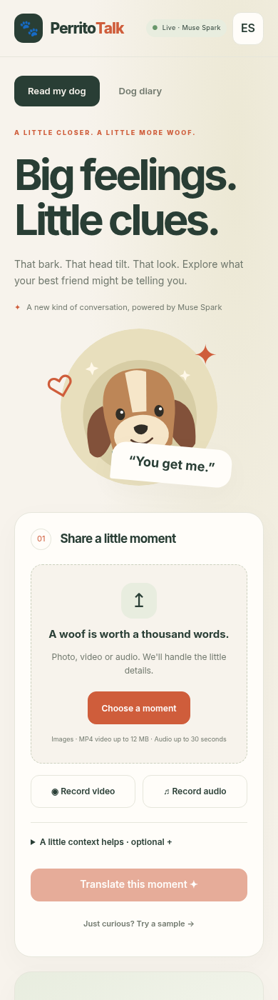
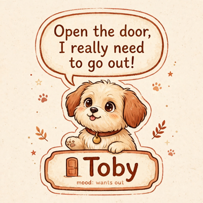
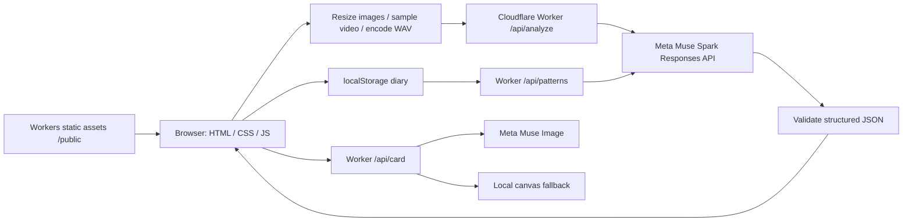

# PerritoTalk 🐾

Big feelings. Little clues. A mobile-first bilingual dog-behavior interpreter built for the **Meta Model API Hackathon**.

Live demo: **https://perritos.edevcore.com**.

Dogs communicate through a combination of sounds, posture and movement. PerritoTalk helps caregivers explore those signals with conservative interpretations and practical next steps. **Interpretation, not a diagnosis.** It cannot reliably infer a dog's internal state or replace a qualified veterinarian or behavior professional. Seek urgent veterinary care for emergencies.

## Features

- Upload a photo, video or audio; record camera/microphone clips with a 30-second automatic stop.
- Camera mode: batch 1–8 timestamped CCTV exports, timeline, evidence-based alerts and optional diary saving.
- English/Spanish interface, defaulting to browser language, with a persistent toggle.
- Warm, responsive design, dark-mode support, accessible controls and reduced-motion support.
- Structured readings: possible needs, confidence, observed signals, translated first-person phrase, next steps and veterinary alerts.
- Local dog diary (latest 100 readings), thumbnails, need frequency and time-of-day bars; ask Muse about patterns.
- Muse Image share cards with a browser canvas fallback, JPEG download (PNG for canvas fallback) and native Web Share where supported.
- Optional browser text-to-speech. A bundled original SVG dog powers the sample demo.

## How it uses Meta

The Worker calls `https://api.meta.ai/v1/responses` with **Muse Spark (`muse-spark-1.3`)**, multimodal image/video/audio content, conservative system instructions, low reasoning effort, and a strict JSON schema. MP4 includes embedded audio. Image inputs become JPEGs up to 1024 px. MP4 videos up to 12 MB pass through; other or larger video becomes four chronological JPEG frames up to 768 px plus mono 16 kHz WAV audio (first 30 seconds). Audio uploads and recordings become mono 16 kHz WAV, capped at 30 seconds. Maximum decoded media per request: 15 MB; maximum HTTP JSON body: 21 MB; maximum source file: 100 MB.

Browser codec support varies. If a video container's audio cannot be decoded, analysis stops rather than silently sending frames alone; export an MP4 with audio under 12 MB or upload WAV separately. Videos with unreadable duration/codecs require an MP4 export. Camera and microphone require HTTPS or localhost and browser permission.

Diary pattern analysis uses the same structured Responses API. Cards use **Muse Image (`muse-image-1.0`)** at `/v1/images/generations`, returning a 1024×1024 JPEG. Image generation failure falls back to local canvas. Analysis failures return a safe 502 instead of silently presenting mock content as live.

Without `MODEL_API_KEY`, or with `?mock=1`, the APIs return explicitly marked deterministic demos. Door/puerta context yields wants-out, limp/cojea/pain context yields a pain warning. Mock outputs never claim the uploaded content was inspected. Demo diary entries are marked as such and sent with their mode during pattern analysis. The live/mock health badge shows backend availability; each result has its own provenance badge.

## Screenshots




## Architecture



## Project structure

```text
src/
  index.ts       Worker routing, request limits and endpoint orchestration
  schema.ts      Strict reading schema, input validation and confidence safeguards
  prompts.ts     Audio-first interpretation and diary instructions
  meta.ts        Meta Responses and image generation adapters
  mock.ts        Explicit deterministic demonstrations
  camera.ts      Camera summary validation and heuristics integration
  stream.ts      Planned streaming contract (501)
public/
  app.js         Bilingual UI, recordings, diary and camera workflow
  media.js       Image/video normalization and WAV encoding
  camera-heuristics.js  Shared browser/server camera alert rules
  index.html     Accessible app shell
  style.css      Responsive styles
  *.svg          Original sample illustration and favicon
tests/          Worker, schema, calibration and camera regression tests
scripts/        Optional local RTSP bridge
docs/           Camera bridge guide, screenshots and CI workflow template
wrangler.jsonc   Worker assets, domain and observability configuration
```

## Setup, run and test

Requires Node.js 22+ and npm. There is no frontend framework, bundler or build step.

```bash
npm install
cp .dev.vars.example .dev.vars
# Set MODEL_API_KEY in .dev.vars for live mode; leave empty for demo.
npm run dev -- --port 8787
```

Open `http://localhost:8787`. Try a sample always runs mock, even with a live key. Optional `.env.example` documents the key for other tooling; local Wrangler secrets belong in `.dev.vars`. Never put keys in `/public`.

```bash
npm run typecheck
npm test
npx wrangler deploy --dry-run
curl http://localhost:8787/api/health
curl 'http://localhost:8787/api/analyze?mock=1' \
  -H 'Content-Type: application/json' \
  --data '{"lang":"en","context":{"situation":"waiting by the door"},"media":[{"kind":"image","mime":"image/jpeg","data_b64":"/9j/2Q=="}]}'
```

The curl image is a minimal validation fixture, not a usable live photograph. Tests cover validation, deterministic mocks, structured response extraction and router behavior without network calls.

## Deploy

After reviewing the project, authenticate Wrangler to your Cloudflare account and configure the secret:

```bash
npx wrangler secret put MODEL_API_KEY
npm run deploy
```

`wrangler.jsonc` configures Workers static assets, `/api/*` Worker-first routing, observability and the `perritos.edevcore.com` custom domain. You must control the corresponding Cloudflare zone. No deployment is performed by project setup. See [Cloudflare asset configuration](https://developers.cloudflare.com/workers/static-assets/binding/).

## API reference

All POST endpoints accept JSON; responses use `Cache-Control: no-store`. Add `?mock=1` for deterministic demos. Missing server credentials also select mock mode. Errors: 400 invalid input, 405 unsupported method, 502 upstream/invalid model output; unknown routes return 404.

| Endpoint                   | Request                                         | Response                                                                                                                                                                                                                 |
| -------------------------- | ----------------------------------------------- | ------------------------------------------------------------------------------------------------------------------------------------------------------------------------------------------------------------------------ |
| `GET /api/health`          | None                                            | `ok`, `live`, `model`                                                                                                                                                                                                    |
| `POST /api/analyze`        | `{lang, context, media, source?: "camera"}`     | `primary` (label, emoji, confidence, 1–4 evidence items), `secondary`, `signals`, `dog_says`, `explanation`, `what_to_do`, `vet_alert`, `media_observed`, `disclaimer`, `low_confidence`, `consistency_warnings`, `mode` |
| `POST /api/patterns`       | `{lang, entries}` (1–100 compact diary entries) | `summary`, `patterns`, `tips`, `vet_note`, `mode`                                                                                                                                                                        |
| `POST /api/card`           | `{lang, dog_says, label, emoji, dog_name?}`     | JPEG `b64_json`, `mime`, `mode`; or `{mode:"mock", fallback:true}`                                                                                                                                                       |
| `POST /api/camera/summary` | `{lang, clips}` (1–8 timestamped readings)      | `overall`, `timeline`, `alerts`, `recommendations`, `mode`                                                                                                                                                               |
| `POST /api/camera/stream`  | Reserved                                        | 501 streaming plan                                                                                                                                                                                                       |

`lang` is `en` or `es`. Each media item is `{kind, mime, data_b64}`; 1–5 items, with supported types defined in `src/schema.ts`. `signals.vocalization` contains `type`, `present`, and a description with observed timing/duration; `bark` remains compatible. Vocalization keys: `none`, `bark`, `howl`, `whine` (whimper), `cry` (yelp), `growl`, `pant`, `human_voice_music_noise_only`. Below 0.4 confidence, the server forces `other`, a hedged phrase and the low-confidence badge; conflicting happy/resting labels with whining, crying or howling are capped at 0.39 and flagged. Veterinary alerts are preserved.

## Camera mode / Modo cámara

Use the Camera mode tab to select 1–8 security-camera video exports (including MP4).
Edit each clip's local timestamp (defaults to file lastModified) and optional
context. Clips run sequentially through the existing media normalizer: MP4 ≤12 MB
passes through; larger/other video uses four keyframes plus required WAV; undecodable audio stops analysis.
Each reading POSTs to `/api/analyze` with `source:"camera"`; progress includes any
audio limitation. `/api/camera/summary` accepts `{lang, clips:[{ts, label,
confidence, dog_says, signals, vet_alert, mode?}]}` where `signals` and `vet_alert`
use the existing reading structure and `ts` is an ISO timestamp with timezone.
Muse Spark uses a strict summary schema; the UI shows a vertical timeline,
alerts and recommendations. Save all completed readings explicitly to the diary.

Server heuristics supplement model alerts: two consecutive anxious/fear readings
suggest possible separation anxiety; barking in three clips within 30 minutes
suggests repeated barking; veterinary flags remain visible. Evidence includes
timestamps. These rules do not establish a diagnosis, continuous barking or what
happened between clips. Duplicate alert types merge without reducing severity.
Demo summary / `?mock=1` and a missing API key produce marked deterministic demos;
a summary containing mock readings remains a demo. A failed live request is
reported rather than silently presented as successful analysis; Demo summary can
summarize completed readings after a failure. Clips are not stored server-side.

## Live mode / Modo en vivo

Open Live mode, choose Front/Back, a 10–15 second interval (default 12), and a
session budget (default 20, maximum 100). Press Start to grant camera/microphone
permissions and optionally notifications. HTTPS is required on mobile. The muted,
inline preview supports Chrome Android (WebM) and Safari iOS (MP4), selecting a
supported MediaRecorder MIME type. Camera selection uses facingMode with an
enumerateDevices/deviceId fallback. Keep the page visible; mobile browsers may
suspend background recording. Stop releases all camera/microphone tracks.

Each independently playable segment reuses `media.js`: MP4 ≤12 MB passes through;
other video becomes four keyframes plus WAV. Recorded WebM uses the known segment
length when its container omits duration. Requests use `source:"live"` and the
phone/PC camera prompt. Recording continues while normalization/analysis runs;
only one analysis runs at once, with busy segments dropped and marked. Attempts,
including failures, consume the budget; reaching it stops the session.

A 64×48 canvas samples motion every 500 ms and an AnalyserNode measures RMS.
A segment is skipped only when both stay below constants in `live-logic.js`
(mean RGB difference 0.025, RMS 0.02). The first frame is conservatively active.
Quiet skips appear in the bounded timeline. The overlay shows interpretation,
confidence, evidence and vocalization. Camera heuristics supply anxiety, repeated
barking and veterinary alerts; distress vocalizations also warn. The banner always
appears for a new warning or escalation; permitted notifications and supported
vibration supplement it. Alerts deduplicate by type/severity per session. Demo
readings are labeled and do not trigger device notifications. These observations
do not establish continuous barking or a diagnosis. Live sessions are not saved
to the diary automatically.

En Modo en vivo, elige cámara, intervalo y máximo de análisis; pulsa Iniciar y
permite cámara/micrófono. Detener libera ambos. Se omiten segmentos sin movimiento
ni sonido y se descartan los que llegan durante un análisis. Las alertas aparecen
en pantalla; las notificaciones requieren permiso. Se necesita HTTPS en móviles.

## Limitations, privacy and ethics

Media is **not stored server-side** by this application. For live analysis it passes through the Worker to Meta; generated card text and compact diary entries also go to Meta when explicitly requested. Provider processing/retention is governed by the provider's terms. Request bodies, model output and keys are not logged by application code. Workers observability can record request metadata. Diary thumbnails and readings remain in this browser's localStorage until cleared; original recordings are not persisted by the app. Clear diary deletes local entries. No analytics, external fonts or third-party frontend assets are loaded.

This is a hackathon prototype: add authentication, per-user quotas/rate limiting and abuse controls before exposing a funded API key widely. Confidence is model-reported, with deterministic consistency safeguards; it is not an empirically calibrated probability. Audio classification can still be wrong. Sparse clips cannot establish what happened between recordings. Never punish a dog based on an interpretation. Image-generated text may be imperfect. A language toggle changes interface labels; existing reading phrases stay in the language in which they were generated. Live Meta integration requires an authorized API key; offline tests do not call Meta.

## Roadmap

- Meta realtime/streaming API, if available and authorized, to replace live segment polling.
- [LAN RTSP bridge](docs/camera-bridge.md), motion-triggered segmentation and timestamped aggregation.
- Evaluate vocalization accuracy against labeled clips and improve empirical confidence calibration.
- Authentication, quotas and abuse controls; optional Muse realtime after streaming validation.

## License

[MIT](LICENSE) © 2026 Yamid Nozu / eDev Core.
