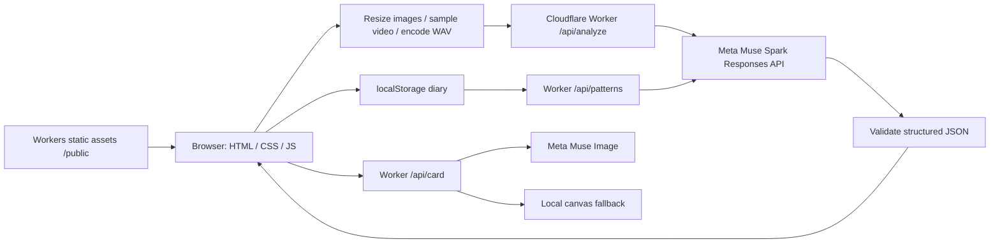

# PerritoTalk 🐾

Big feelings. Little clues. A mobile-first bilingual dog-behavior interpreter built for the **Meta Model API Hackathon**.

Demo URL (deployment target): **https://perritos.edevcore.com**. This repository does not imply the site has been deployed.

Dogs communicate through a combination of sounds, posture and movement. PerritoTalk helps caregivers explore those signals with conservative interpretations and practical next steps. **Interpretation, not a diagnosis.** It cannot reliably infer a dog's internal state or replace a qualified veterinarian or behavior professional. Seek urgent veterinary care for emergencies.

## Features

- Upload a photo, video or audio; record camera/microphone clips with a 30-second automatic stop.
- English/Spanish interface, defaulting to browser language, with a persistent toggle.
- Warm, responsive design, dark-mode support, accessible controls and reduced-motion support.
- Structured readings: possible needs, confidence, observed signals, translated first-person phrase, next steps and veterinary alerts.
- Local dog diary (latest 100 readings), thumbnails, need frequency and time-of-day bars; ask Muse about patterns.
- Muse Image share cards with a browser canvas fallback, PNG download and native Web Share where supported.
- Optional browser text-to-speech. A bundled original SVG dog powers the sample demo.

## How it uses Meta

The Worker calls `https://api.meta.ai/v1/responses` with **Muse Spark (`muse-spark-1.3`)**, multimodal image/video/audio content, conservative system instructions, low reasoning effort, and a strict JSON schema. MP4 includes embedded audio. Image inputs become JPEGs up to 1024 px. MP4 videos up to 12 MB pass through; other or larger video becomes four chronological JPEG frames up to 768 px plus mono 16 kHz WAV audio (first 30 seconds). Audio uploads and recordings become mono 16 kHz WAV, capped at 30 seconds. Maximum decoded media per request: 15 MB; maximum HTTP JSON body: 21 MB; maximum source file: 100 MB.

Browser codec support varies. If a video container's audio cannot be decoded, the UI explicitly reports that only frames will be analyzed; upload audio separately when needed. Videos with unreadable duration/codecs require an MP4 export. Camera and microphone require HTTPS or localhost and browser permission.

Diary pattern analysis uses the same structured Responses API. Cards use **Muse Image (`muse-image-1.0`)** at `/v1/images/generations`, returning a 1024×1024 PNG. Image generation failure falls back to local canvas. Analysis failures return a safe 502 instead of silently presenting mock content as live.

Without `MODEL_API_KEY`, or with `?mock=1`, the APIs return explicitly marked deterministic demos. Door/puerta context yields wants-out, limp/cojea/pain context yields a pain warning. Mock outputs never claim the uploaded content was inspected. Demo diary entries are marked as such and sent with their mode during pattern analysis. The live/mock health badge shows backend availability; each result has its own provenance badge.

## Architecture



## Run locally

Requires Node.js 22+ and npm. There is no frontend framework, bundler or build step.

```bash
npm install
cp .dev.vars.example .dev.vars
# Set MODEL_API_KEY in .dev.vars for live mode; leave empty for demo.
npm run dev -- --port 8787
```

Open `http://localhost:8787`. Try a sample always runs mock, even with a live key. Optional `.env.example` documents the key for other tooling; local Wrangler secrets belong in `.dev.vars`. Never put keys in `/public`.

```bash
npm run typecheck
npm test
npx wrangler deploy --dry-run
curl http://localhost:8787/api/health
curl 'http://localhost:8787/api/analyze?mock=1' \
  -H 'Content-Type: application/json' \
  --data '{"lang":"en","context":{"situation":"waiting by the door"},"media":[{"kind":"image","mime":"image/jpeg","data_b64":"/9j/2Q=="}]}'
```

The curl image is a minimal validation fixture, not a usable live photograph. Tests cover validation, deterministic mocks, structured response extraction and router behavior without network calls.

## Deploy

After reviewing the project, authenticate Wrangler to your Cloudflare account and configure the secret:

```bash
npx wrangler secret put MODEL_API_KEY
npm run deploy
```

`wrangler.jsonc` configures Workers static assets, `/api/*` Worker-first routing, observability and the `perritos.edevcore.com` custom domain. You must control the corresponding Cloudflare zone. No deployment is performed by project setup. See [Cloudflare asset configuration](https://developers.cloudflare.com/workers/static-assets/binding/).

## Privacy and limitations

Media is **not stored server-side** by this application. For live analysis it passes through the Worker to Meta; generated card text and compact diary entries also go to Meta when explicitly requested. Provider processing/retention is governed by the provider's terms. Request bodies, model output and keys are not logged by application code. Workers observability can record request metadata. Diary thumbnails and readings remain in this browser's localStorage until cleared; original recordings are not persisted by the app. Clear diary deletes local entries. No analytics, external fonts or third-party frontend assets are loaded.

This is a hackathon prototype: add authentication, per-user quotas/rate limiting and abuse controls before exposing a funded API key widely. Confidence is model-reported and uncalibrated. Image-generated text may be imperfect. A language toggle changes interface labels; existing reading phrases stay in the language in which they were generated. Live Meta integration requires an authorized API key and was not exercised by offline tests.

MIT © 2026 Yamid Nozu / eDev Core.
